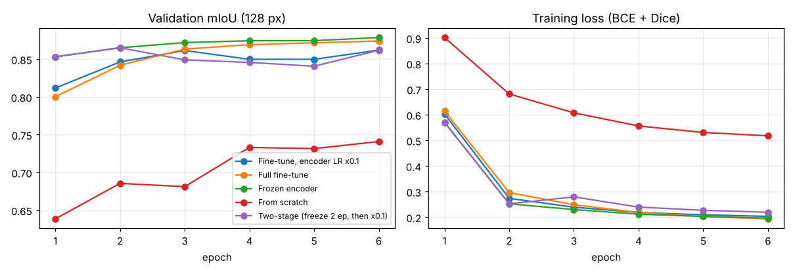
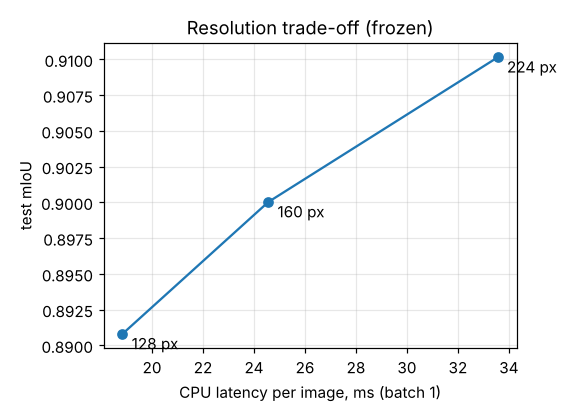
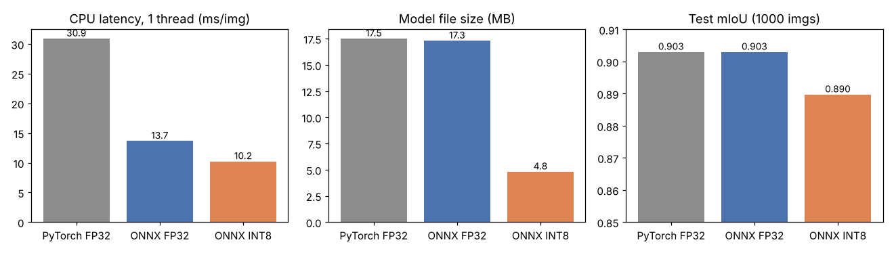
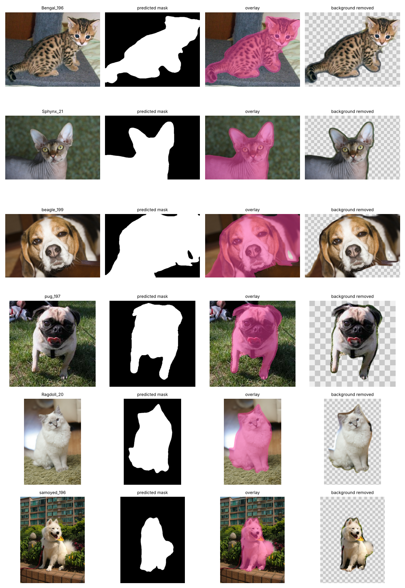

# PetVision — Technical Report

Cat/dog segmentation on the Oxford-IIIT Pet dataset: find the animal in a photo and cut it out from the background.

All numbers below come from real runs in this repo (CPU only, 2 cores). Raw logs are in `runs/*/history.json`, and every table here is generated by a script in `scripts/` or `src/petvision/`.

---

## 1. What problem does the project solve?

Given a photo of a cat or dog, the system predicts a pixel mask: 1 = animal, 0 = background. With the mask you can:

- remove the background (transparent PNG cutout),
- put the pet on a new background,
- get the pet's bounding box and how much of the frame it takes up.

This is binary semantic segmentation. It's the same thing "remove background" features in photo apps do, but specialised for pets, small enough to run on a laptop CPU in 10–15 ms per image.

## 2. Data

**Dataset:** Oxford-IIIT Pet (Parkhi et al., 2012), downloaded from the official site. 37 breeds (12 cat, 25 dog), about 200 images per breed. Each image has a *trimap*: 1 = pet, 2 = background, 3 = "boundary / not sure".

What I found in the EDA (`scripts/eda.py`, outputs in `results/eda/`):

| | |
|---|---|
| Labelled images | 7,349 (official trainval 3,680 + test 3,669) |
| Species | 4,978 dogs, 2,371 cats (2.1 : 1) |
| Images per breed | 184–200 (balanced across breeds) |
| Image size | median 500×375, ranges from 114 px up to 3264 px wide |
| Pet share of the image | 42% on average, 5th–95th percentile 14%–74% |
| Boundary label | 12% of all pixels, **28% of foreground pixels** |
| Odd files | 3 RGBA images; 14 trimaps with **no pet labelled at all** (7 in test) |

**Splits.** I kept the official test split untouched and split the official trainval into train (3,311) / validation (369), stratified by breed with a fixed seed. Validation is used for picking epochs and comparing strategies; test is only used for the final numbers.

**Label decision: boundary → foreground.** The boundary band is the fur outline, so it belongs to the animal. I mapped pet + boundary → 1. Because the band is thick (28% of the foreground!), this choice matters a lot, and it shows up later in the error analysis. I also report IoU with the boundary pixels ignored as a second metric.

**Preprocessing.** Images are resized (squashed) to a square N×N and normalised with ImageNet mean/std. For CPU training I cache the resized images as uint8 arrays (`data/cache/*.npz`) so JPEGs are not decoded and resized again every epoch.

**Augmentation** (vectorised on the batch, `data.py:augment_batch`): random horizontal flip, zoom 0.75–1.0, rotation ±15°, translation, brightness/contrast ±20%. The mask gets the same geometric transform with nearest-neighbour sampling so it stays binary.

## 3. Model and why

**U-Net decoder + MobileNetV3-Large encoder pretrained on ImageNet** (via `segmentation_models_pytorch` + `timm`). 4.5 M parameters, 17.5 MB.

Why this combination:
- **U-Net**: skip connections give sharp boundaries; it's the standard baseline for binary segmentation and works with small datasets.
- **MobileNetV3**: I had to train on a 2-core CPU, and the demo should run on a normal laptop. A ResNet-50 encoder has ~5× more parameters and would be several times slower. MobileNetV3 was designed for mobile inference.
- **Pretrained encoder**: 3.3k training images is small. ImageNet already contains cat and dog classes, so its features should transfer very well. (Experiment 1 checks this.)

**Loss:** BCE + soft Dice. BCE gives stable per-pixel gradients; Dice directly optimises overlap and is less sensitive to the foreground/background ratio changing from image to image.

**Optimiser:** AdamW, LR 1e-3, weight decay 1e-4, batch 16, half-epoch linear warm-up then cosine decay. The checkpoint with the best validation mIoU is kept.

## 4. Metrics

For a predicted mask P and ground truth G:

- **IoU** = |P ∩ G| / |P ∪ G|
- **Dice** = 2|P ∩ G| / (|P| + |G|)  (per image, Dice = 2·IoU / (1 + IoU), so Dice is always ≥ IoU)
- **mIoU / mDice** = mean over images (every photo counts the same — closest to what a user sees). I also log dataset-level "micro" IoU and pixel accuracy.
- **Inference speed** = ms per image at batch size 1 on CPU (mean of 30–50 runs after warm-up).

Pixel accuracy is reported but not used for decisions: always predicting "background" already gets ~58%.

**Important:** the final test metrics are computed at the **original image resolution** (the predicted logits are upsampled back to the photo size), not at the small training resolution. This is stricter and matches real use.

## 5. Experiments

Every run: same seed, same split, same LR schedule, same augmentations. Strategy and resolution comparisons use the same budget of 6 epochs. "Test mIoU" in these tables = a fixed, breed-balanced subset of 1,000 official test images (every 3rd image) so all runs are compared on identical data. Script: `scripts/run_experiments.sh` → `scripts/compare_experiments.py`.

### Experiment 1 — transfer learning strategy (128 px, 6 epochs)

| Strategy | Trainable params | Time / epoch | Val mIoU | Test mIoU | Test Dice |
|---|---|---|---|---|---|
| From scratch (random init) | 4.53 M | 1.9 min | 0.741 | 0.746 | 0.844 |
| **Frozen encoder** (train decoder only) | **1.56 M** | **1.1 min** | **0.879** | **0.891** | **0.940** |
| Full fine-tune (same LR everywhere) | 4.53 M | 1.9 min | 0.874 | 0.888 | 0.938 |
| Fine-tune, encoder LR × 0.1 | 4.53 M | 1.9 min | 0.862 | 0.879 | 0.932 |
| Two-stage (2 epochs frozen, then unfreeze with LR × 0.1) | 1.56 → 4.53 M | 1.1 → 1.9 min | 0.865 | 0.876 | 0.932 |

What this shows:
- **Pretraining is the biggest factor by far: +14.5 IoU points** (0.746 → 0.891). From scratch, the model is still learning low-level features after 6 epochs (its training loss is ~2.5× higher).
- **Freezing the encoder was the best and cheapest option** in this budget: 40% faster epochs, 3× fewer trainable weights, and the most stable validation curve.
- The unfrozen variants have bumpier validation curves (e.g. two-stage *drops* from 0.865 to 0.849 right after unfreezing). My explanation: when the encoder is unfrozen, its BatchNorm layers start updating their running statistics from small batches of 16, and the pretrained features shift before the decoder can adapt. With a frozen encoder, BatchNorm stays in eval mode and nothing shifts.
- Caveat: differences between the four pretrained variants are 1–1.5 points with a single seed and a 369-image validation set, so I treat the order among them as "probably real but small", not as a strong conclusion.

### Experiment 2 — input resolution (frozen encoder, 6 epochs)

| Input size | Time / epoch | Val mIoU | Test mIoU | Test Dice | CPU latency (PyTorch, ms/img) |
|---|---|---|---|---|---|
| 128 × 128 | 1.1 min | 0.879 | 0.891 | 0.940 | 18.8 |
| 160 × 160 | 1.5 min | 0.890 | 0.900 | 0.945 | 24.6 |
| 224 × 224 | 3.0 min | 0.898 | 0.910 | 0.951 | 33.6 |

Higher resolution helps steadily (+0.9 points per step) because edges and thin parts (legs, ears, tails) survive downscaling better. But cost grows roughly with the number of pixels: 224 px is ~1.4× slower at inference and 2× slower to train than 160 px.

**Decision: 160 px** for the released model. It keeps most of the accuracy gain over 128 px and stays fast on CPU. If accuracy mattered more than speed, 224 px is the obvious next step (+1 point).

### Experiment 3 — is "frozen wins" just because of the short budget? (160 px, 15 epochs)

A fair worry about Experiment 1: maybe full fine-tuning just needs more epochs. So I trained both for 15 epochs at 160 px.

| Strategy | Time / epoch | Total time | Best val mIoU | Test mIoU (1k) | Final train loss |
|---|---|---|---|---|---|
| Frozen encoder | 1.5 min | 23 min | **0.8935** | 0.9030 | 0.141 |
| Full fine-tune | 2.7 min | 42 min | 0.8923 | **0.9036** | 0.133 |

Result: with more epochs, full fine-tuning **catches up** — the two are tied (difference < 0.1 point, well inside noise). Fine-tuning fits the training set a bit better (lower train loss) but that doesn't turn into better test IoU. So the frozen encoder is the better *engineering* choice: same accuracy, ~half the training cost. The released model is the 15-epoch frozen-encoder model.

### Experiment 4 — test-time augmentation (horizontal flip)

Averaging the prediction on the image and its mirror: test mIoU 0.8993 → 0.9018 (+0.25 points), but inference time goes from 15.6 to 25.6 ms. Small gain, 1.6× cost — available as a `--tta` flag but off by default.

## 6. Final evaluation (full official test set, 3,669 images, original resolution)

Model: `weights/petvision_unet_mnv3.pt` (frozen MobileNetV3 encoder, U-Net decoder, 160 px). Script: `python -m petvision.evaluate`.

| Metric | Value |
|---|---|
| mIoU | **0.899** |
| mDice | **0.944** |
| Pixel accuracy | 0.959 |
| Dataset-level IoU | 0.903 |
| mIoU ignoring the boundary band | 0.928 |
| mIoU cats / dogs | 0.897 / 0.900 |
| mIoU without the 7 images that have empty ground truth | 0.901 |
| Images with IoU < 0.8 / < 0.5 | 7.3% / 0.7% |
| Median per-image IoU | 0.918 |

(The 1,000-image subset gave 0.903 for the same model; the full set is a bit lower — a reminder that 0.3-point gaps between runs are not meaningful.)

### Error analysis

**Where are the wrong pixels?** On average **69% of wrongly classified pixels lie within 5 px of the true outline.** So most errors are boundary placement, not missing the animal. This is also why ignoring the trimap's "unsure" band raises mIoU from 0.899 to 0.928. The labels themselves are thick at the edges, so the model learned to predict a slightly "fat" mask — you can see a thin halo of background around the cutouts in the demo.

**Object size matters a lot:**

| Pet share of image | Images | mIoU |
|---|---|---|
| < 10% (small, far away) | 70 | 0.795 |
| 10–20% | 378 | 0.861 |
| 20–40% | 1,323 | 0.888 |
| 40–60% | 1,211 | 0.914 |
| > 60% (close-up) | 680 | 0.935 |

Small pets lose detail at 160 px input — a 40-pixel cat in a 500-pixel photo becomes ~13 pixels.

**Hardest / easiest breeds:** Sphynx (0.861), Bengal (0.861), Miniature Pinscher (0.871) vs Leonberger (0.928), Samoyed (0.927), British Shorthair (0.923). Hairless cats and spotted Bengals have skin/fur textures that blend with backgrounds (blankets, carpets); big fluffy breeds have clear shapes.

**Worst cases** (`results/eval_final/worst_cases.png`): the 7 lowest-IoU images all have an **empty ground-truth mask** — annotation errors in the dataset. In several of them (Egyptian Mau 20, both Saint Bernards, Wheaten Terrier 195) the model's mask is actually correct, but it scores IoU = 0. The real failures after those are: (1) small pets in cluttered gardens (Bengal 30 — missed completely), (2) white fluffy close-ups on white bedding where fur and blanket look the same.

## 7. Optimization

Goal: faster and smaller inference without retraining. Script: `python -m petvision.optimize`. All variants evaluated on the same 1,000 test images; latency at batch 1, 160 px.

| Variant | File size | Latency 1 thread | Latency 2 threads | Test mIoU | Test Dice |
|---|---|---|---|---|---|
| PyTorch FP32 (baseline) | 17.5 MB | 30.9 ms | 26.7 ms | 0.903 | 0.947 |
| ONNX FP32 (onnxruntime) | 17.3 MB | 13.7 ms | 9.3 ms | 0.903 | 0.947 |
| ONNX INT8 (static PTQ) | **4.8 MB** | **10.2 ms** | 9.6 ms | 0.890 | 0.938 |

- **ONNX export: 2.3–2.9× faster with identical accuracy.** onnxruntime fuses Conv+BN+activation and avoids Python overhead. Free win.
- **INT8 quantization: 3.6× smaller, another 1.3× faster on one thread**, but **−1.3 IoU points**. With 2 threads there was no extra speed-up over FP32 ONNX on this machine (the model is already so small that threading overhead dominates).

**Quantization calibration ablation** (`scripts/quant_ablation.py`, 1,000 test images):

| Calibration | Test mIoU |
|---|---|
| MinMax | 0.877 |
| Entropy | 0.877 |
| **Percentile 99.99%** (used) | **0.890** |
| Percentile + keep last 3 convs in FP32 | 0.890 (and slower) |

Clipping activation outliers (percentile) clearly beats MinMax, which wastes INT8 range on rare extreme values. Keeping the final layers in FP32 did not help, so the loss comes from earlier, the MobileNetV3 encoder (depthwise convs + hard-swish are known to be quantization-sensitive).

**Decision:** the demo/API use **ONNX FP32** by default (same accuracy as PyTorch, ~2.5× faster). INT8 is shipped as the option for when file size matters (mobile, browser).

## 8. Practical application

- **Web demo** (`app/gradio_app.py`): upload a photo → mask, overlay, transparent PNG cutout, pet on a new background colour, plus a line with coverage and latency.
- **REST API** (`app/api.py`, FastAPI): `POST /segment?output=mask|cutout|overlay|background` returns an image; `POST /segment/info` returns JSON (foreground fraction, bounding box, mean confidence, latency). Bad uploads return HTTP 400.
- **CLI** (`python -m petvision.predict`): runs on a file or a whole folder, writes mask / overlay / cutout for each image.

The cutout uses the probability map as a soft alpha (probabilities 0.3–0.7 are blended), so fur edges look less jagged than a hard 0/1 mask.

## 9. Challenges and how I handled them

1. **No GPU.** Everything was trained on a 2-core CPU. I picked a mobile encoder, cached resized images as arrays, made augmentation batch-level and vectorised, and kept comparison runs short (6 epochs) with identical budgets. The full experiment set (9 training runs) took ≈ 2.5 h.
2. **Unclear boundary labels.** Decided to merge them into foreground, and report a second metric that ignores them, so the effect is visible instead of hidden.
3. **Annotation errors** (empty masks). Found them through error analysis instead of trusting the numbers. Reported both the official and the "clean" metric.
4. **Is a comparison fair?** A short budget can favour the cheapest method, so I ran Experiment 3 to check — and it changed the conclusion from "frozen is better" to "frozen is equally good and cheaper".
5. **INT8 accuracy drop.** Tried several calibration methods and partial FP32 layers instead of just accepting the first result.

## 10. Strengths and weaknesses

**Strengths**
- 0.90 mIoU / 0.94 Dice on the official test set with a 4.5 M-parameter model.
- 10–14 ms per image on one CPU core (ONNX INT8 / FP32), 4.8 MB INT8 model available.
- Whole pipeline is reproducible from scripts; every claim has a log or table behind it.
- Honest evaluation: original resolution, untouched test set, error analysis by size / breed / pixel location.

**Weaknesses**
- Masks are slightly "fat" around the fur (comes from the label choice) → visible halo in cutouts.
- Weak on small, far-away pets (0.80 mIoU below 10% coverage).
- Only cats and dogs. Given a photo with no pet, it can still mark something; there is no "no pet" classifier (the app only warns when <1% of pixels are foreground).
- Several animals in one photo are merged into one mask (no instance separation).
- Single seed per experiment; small differences (<1 point) are not statistically confirmed.
- Squash-resizing distorts very wide or tall photos.

## 11. What I would do with more time and resources

1. **GPU + longer training** at 224–320 px, and a stronger encoder (EfficientNet-B3 / ConvNeXt-Tiny), probably +2–3 IoU points.
2. **Better edges:** train with the boundary band *ignored* in the loss (or as a soft label), then add matting-style refinement for fur. That should remove the halo.
3. **Clean labels:** drop/fix the 14 empty trimaps, and re-run the experiments with 3 seeds each to get error bars.
4. **Small pets:** tiled or two-pass inference (detect → crop → segment at high resolution).
5. **Quantization-aware training** to close the 1.3-point INT8 gap; then try running INT8 ONNX in the browser (onnxruntime-web).
6. **"Is there a pet?" head** and instance masks (Mask R-CNN / YOLO-seg) for multi-pet photos.
7. Keep aspect ratio with letterbox padding instead of squashing.

## References

- O. M. Parkhi, A. Vedaldi, A. Zisserman, C. V. Jawahar. *Cats and Dogs.* CVPR 2012. (Oxford-IIIT Pet dataset)
- O. Ronneberger, P. Fischer, T. Brox. *U-Net: Convolutional Networks for Biomedical Image Segmentation.* MICCAI 2015.
- A. Howard et al. *Searching for MobileNetV3.* ICCV 2019.
- P. Iakubovskii. *Segmentation Models PyTorch*, github.com/qubvel-org/segmentation_models.pytorch
- ONNX Runtime quantization docs, onnxruntime.ai/docs/performance/model-optimizations/quantization.html
